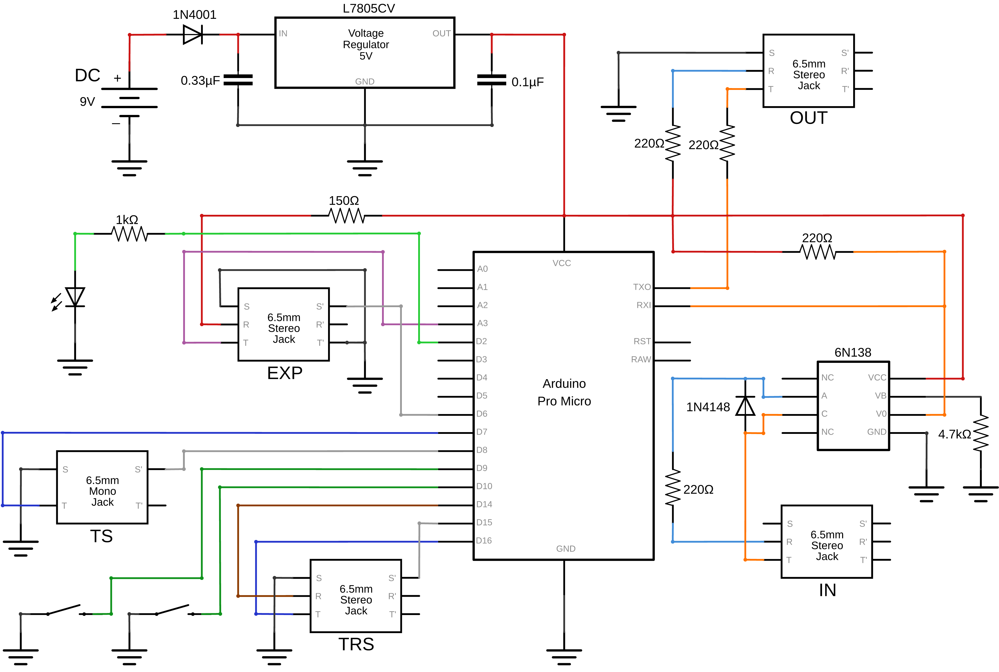

# MIDI-GP 🔘


## Table of Contents

- [Description](#description)
    - [Project](#project)
    - [Repository](#repository)
    - [Technical Details](#technical-details)
- [Gallery](#gallery)
    - [Circuit Diagram](#circuit-diagram)
    - [Hardware Assembly](#hardware-assembly)
- [Usage](#usage)
    - [Configuration](#configuration)
    - [Calibration](#calibration)
    - [Debugging](#debugging)
- [License](#license)


## Description

### Project
**MIDI-GP** acts as a foot-operated hub for sending MIDI messages to compatible music gear, such as multi-effects processors. The device features two programmable onboard footswitches, with expansion options for single and dual external footswitches via TS and TRS inputs, as well as an expression pedal input. Additional MIDI connectivity is also provided via a MIDI IN port, allowing incoming Control Change (CC) and Program Change (PC) messages to be forwarded to the MIDI OUT port.

### Repository
The code in this repository is organized into two directories, namely [*src*](src) and [*include*](include), which contain the source (`.cpp`) and header (`.h`) files of the project, respectively. Moreover, the [*img*](img) directory contains all images displayed in the present documentation.

### Technical Details
This project was developed using *Visual Studio Code* on `Windows 10`, with the *PlatformIO* extension employed to upload the code to the *ATmega32U4* microcontroller embedded in an *Arduino*-compatible *Pro Micro* board. The device is designed to be powered by an external 9V power supply, facilitating its integration into a pedalboard, while a 5V voltage regulator subcircuit along with a reverse polarity protection diode is used to supply power to the microcontroller. Moreover, a 150Ω resistor prevents shorting the power rails during hot-plugging of the expression pedal. Lastly, an LED with a 1kΩ current-limiting resistor provides visual feedback during message transmission, while the MIDI IN and OUT ports follow the standard *Type-A* TRS MIDI interface design.


## Gallery

### Circuit Diagram


### Hardware Assembly
")
")


## Usage

### Configuration

To customize the device for your needs, you may need to adjust some of the variables defined in the [`Configuration.h`](include/Configuration.h) file. For example, to set the desired MIDI channel and CC number associated with the expression pedal, simply modify the following variables:

```cpp
constexpr uint8_t MIDI_CHANNEL = 1;
constexpr uint8_t MIDI_CC_EXPRESSION = 12;
```

Note that the footswitches support both *press* and *hold* gestures, each associated with its own configurable CC number. Moreover, the onboard footswitches (`BUTTON 1` & `BUTTON 2`) and the external dual footswitch (`BUTTON 3` & `BUTTON 4`) also support simultaneous gestures, with dedicated CC numbers assigned to each group.

### Calibration

To ensure proper behavior of the expression pedal, you will first need to calibrate the device. To enter calibration mode, *hold* both of the onboard footswitches until the LED indicator starts blinking. Then, move the pedal through its full range of motion and repeat the same gesture to exit calibration mode. Note that this particular gesture is reserved for entering and exiting calibration mode and thus cannot be assigned a CC number.

### Debugging

In case you encounter any issues, you can connect the *Pro Micro* board to a computer via USB and inspect diagnostic messages through a serial monitor, such as the ones provided by the *Arduino IDE* or the *PlatformIO* extension. To enable debugging, simply open the [`Configuration.h`](include/Configuration.h) file and change the `DEBUG` macro definition from `0` to `1`, as shown below:

```cpp
#define DEBUG 1
```


## License

*MIDI-GP* © *2026* by *Alexandros Iliadis* is licensed under the [MIT License](https://choosealicense.com/licenses/mit/).

A short and simple permissive license with conditions only requiring preservation of copyright and license notices. Licensed works, modifications, and larger works may be distributed under different terms and without source code.

See the [`LICENSE.md`](LICENSE.md) file for more details.